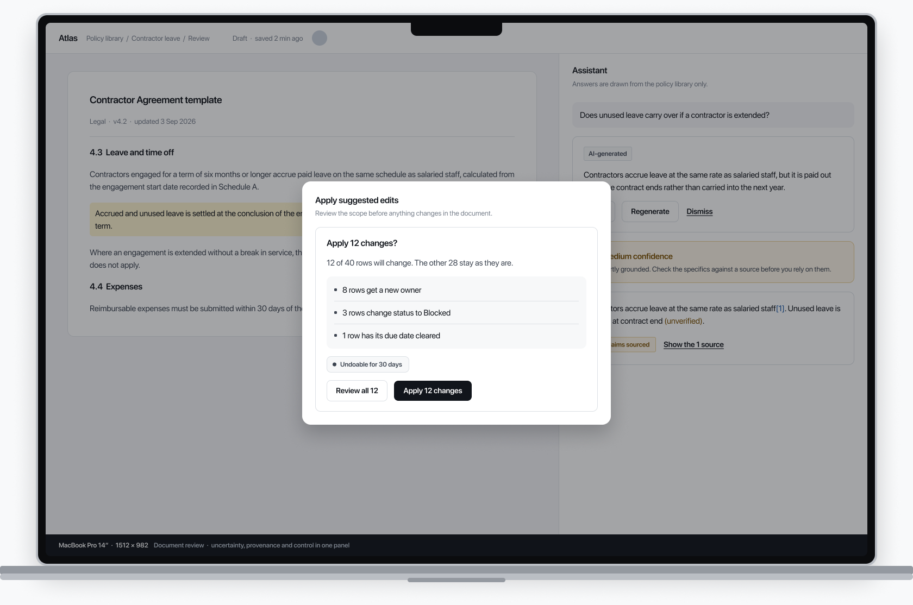
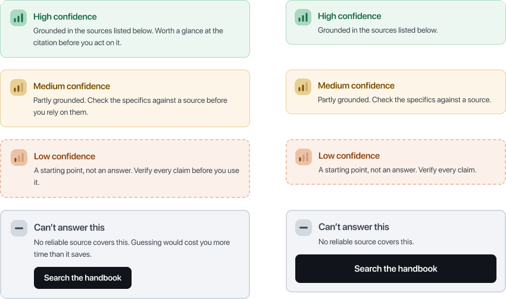
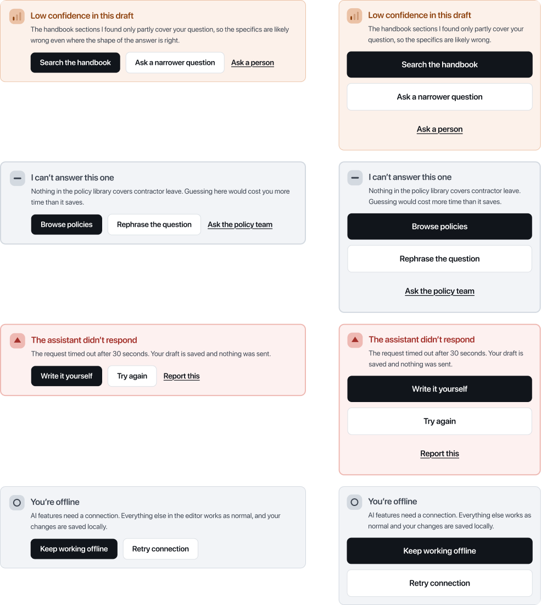
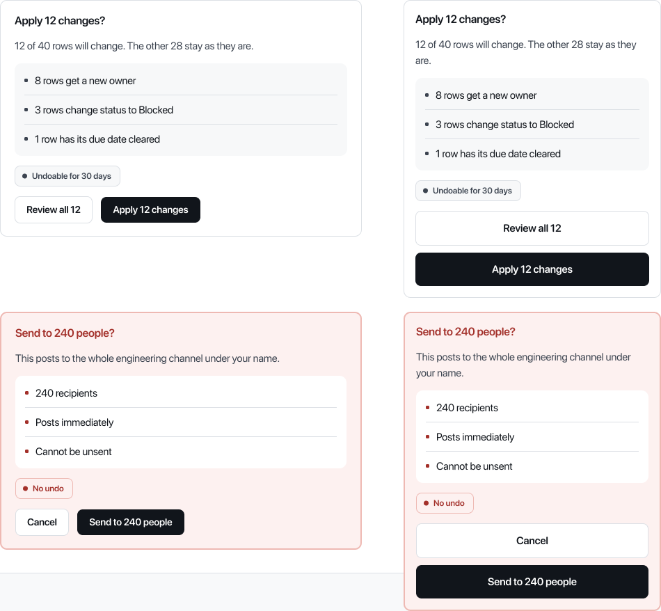
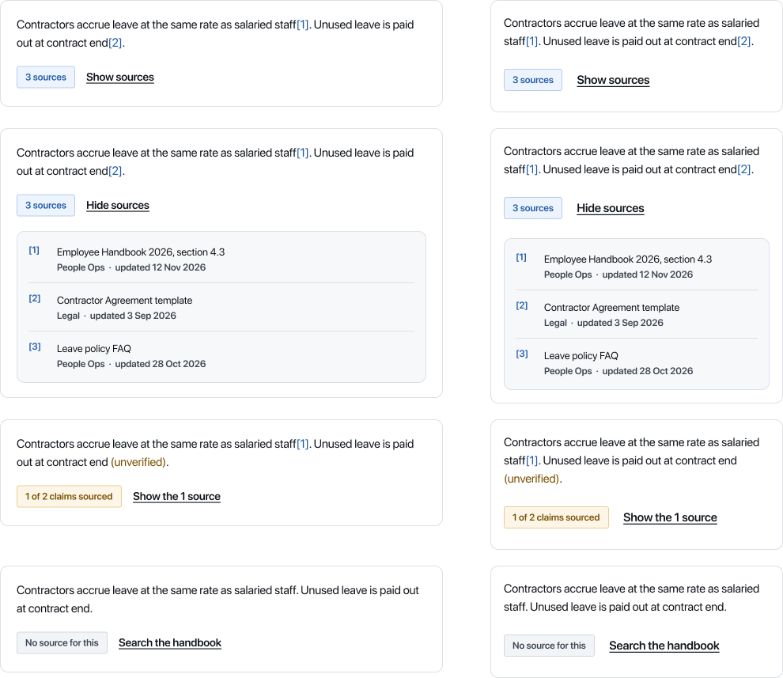
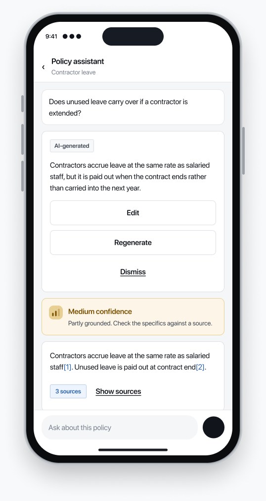
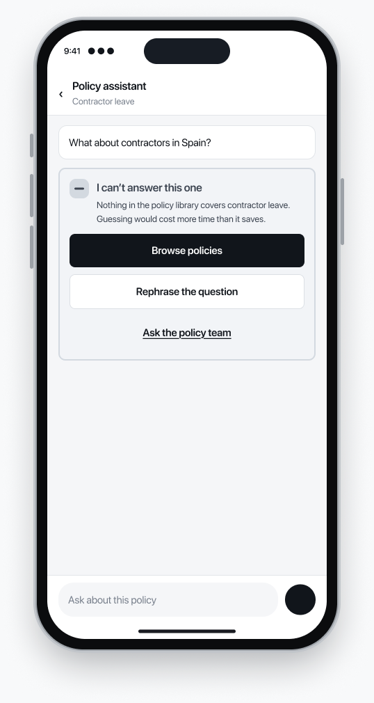
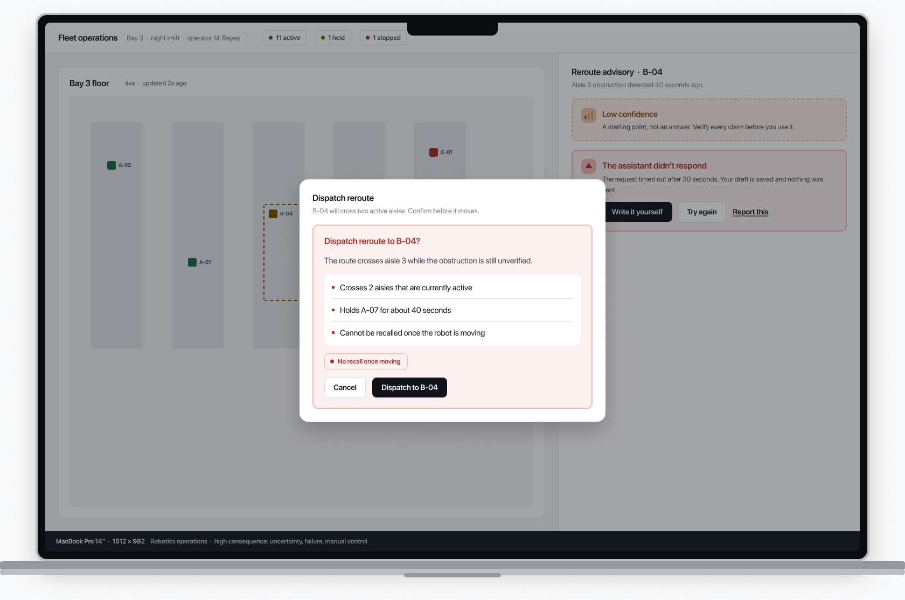
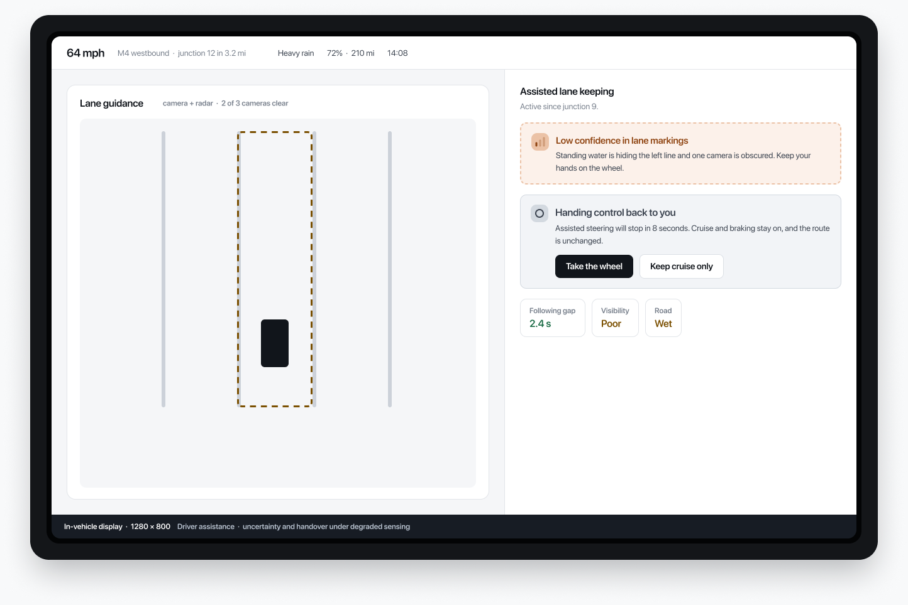
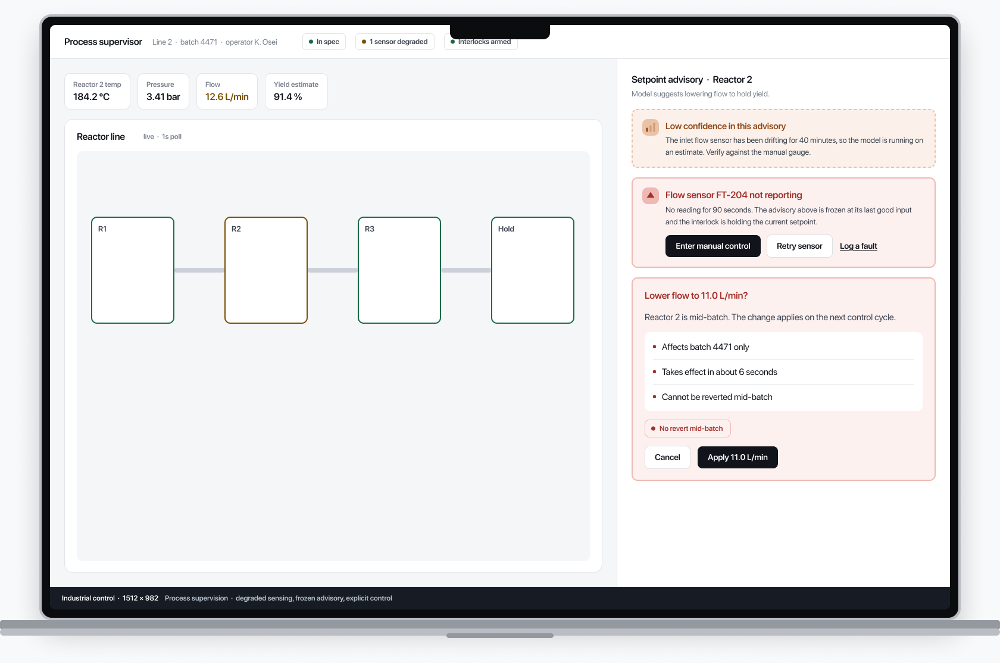

# AI Interaction Pattern Library

Patterns for designing AI interfaces that people can trust, steer, and recover from.

[](LICENSE)
[](patterns/)
[](principles.md)

This library focuses on the harder problems of AI interaction: making uncertainty visible and actionable, preserving user control and reversibility, designing for graceful failure and manual fallbacks, providing provenance without overload, and ensuring accessibility. It is deliberately grounded in Apple's Human Interface Guidelines (Generative AI and Machine Learning) and Google's People + AI Guidebook.



## Open the component library in Figma

**[AI Interaction Pattern Library · Figma file](https://www.figma.com/design/YqEqVIuX639b3zh9ljDinP/Research)**

Every pattern here is a built component set with Web and Mobile variants, bound tokens, published text styles, and a documentation panel beside it. The file also holds six validation screens showing the patterns inside real product surfaces.

## Background

At CSL Behring I independently explored an AI design system and pattern library covering components and states for AI interaction patterns. I presented the work to the team. It remained internal.

This library is the next step: a more rigorous, public set of principles and patterns that others can use and build on.

Built by **Marian Gasinu**, a product designer working on AI interfaces. Portfolio at [mariangasinu.com](https://mariangasinu.com). This repository contains no CSL Behring material, data, or proprietary work. It is an independent project, written from published guidance and built from scratch.

## Contents

- [Principles](principles.md) covers six principles with do/don't guidance and acceptance criteria
- [Patterns](patterns/) covers Uncertainty Signaling, Graceful Failure & Manual Fallback, User Control & Reversibility, Provenance / Source Display
- [Claude skill](claude/) holds instructions for using the principles when generating UI
- [Reviewer's short list](principles.md#reviewers-short-list) is thirteen questions to run against any screen

Figma components and validation screens (web, mobile, robotics, vehicle, industrial) are available in the linked Figma file.

## The components

**Uncertainty Signal.** Four qualitative bands in place of a raw confidence score. Each state is carried three times over, by bar count, text label and colour, so no single channel is load-bearing.



**Fallback Block.** Graceful failure with a manual path. The primary action is never "try again".



**Approval Step.** Consent before a consequential action, with the scope counted and itemised before commit.



**Source Display.** Provenance at the grain that supports checking, with markers on the claims they support.



## Validation screens

Six composed screens, each built from instances of the real component sets rather than redrawn for the picture. Frames are at true device sizes.

| | |
|---|---|
|  |  |
| **iPhone 17 Pro** · sourced answer | **iPhone 17 Pro** · cannot answer |


**MacBook Pro 14 inch** · robotics operations. An inferred obstruction is marked low confidence, a lost link hands back manual control, and dispatch states it cannot be recalled.


**In-dash display** · driver assistance. Standing water degrades lane detection, so the system says what it cannot see and hands back the wheel.


**MacBook Pro 14 inch** · industrial control. A drifting sensor makes the advisory low confidence; when it drops out entirely the advisory freezes and the interlock holds.

## Using the library

Start with the principles. Each pattern document maps to specific principles, includes when-to-use guidance, accessibility notes, and acceptance criteria. The Figma file contains the component sets and composed examples.

**Designing something.** Find the pattern, read its "when not to use" section before its variants. Most mistakes in AI UI are a pattern applied where it does not belong, not a pattern built badly.

**Reviewing something.** Run the [reviewer's short list](principles.md#reviewers-short-list), then the acceptance criteria on whichever patterns the screen uses. Both are written as checks rather than opinions, so a review produces a pass or a fail rather than a discussion.

**Contributing a pattern.** See [patterns/README.md](patterns/README.md) for the required structure. A pattern names the principles it serves and does not violate any of them. Where a pattern genuinely pulls against a principle, that tension belongs in the write-up rather than hidden in it.

## Index: principles to patterns

Every pattern serves at least one principle. Every principle should eventually have patterns that make it concrete. This table is the map between them, and the gaps in it are the roadmap.

| Principle | Patterns |
|---|---|
| [1. Make uncertainty visible and actionable](principles.md#1-make-uncertainty-visible-and-actionable) | [Uncertainty Signaling](patterns/uncertainty-signaling.md) · [Provenance / Source Display](patterns/provenance.md) (coverage vs reliability) |
| [2. Preserve control and reversibility](principles.md#2-preserve-control-and-reversibility) | [User Control & Reversibility](patterns/user-control.md) · [Graceful Failure & Manual Fallback](patterns/graceful-failure.md) (action hierarchy, cancel) |
| [3. Design for graceful failure and a manual path](principles.md#3-design-for-graceful-failure-and-a-manual-path) | [Graceful Failure & Manual Fallback](patterns/graceful-failure.md) · [Uncertainty Signaling](patterns/uncertainty-signaling.md) (cannot-answer state) |
| [4. Provide provenance without overload](principles.md#4-provide-provenance-without-overload) | [Provenance / Source Display](patterns/provenance.md) |
| [5. Build for accessibility](principles.md#5-build-for-accessibility) | [User Control & Reversibility](patterns/user-control.md) · [Provenance / Source Display](patterns/provenance.md) · [Graceful Failure & Manual Fallback](patterns/graceful-failure.md) · [Uncertainty Signaling](patterns/uncertainty-signaling.md) |
| [6. Avoid generic AI slop](principles.md#6-avoid-generic-ai-slop) | [User Control & Reversibility](patterns/user-control.md) · [Provenance / Source Display](patterns/provenance.md) · [Graceful Failure & Manual Fallback](patterns/graceful-failure.md) · [Uncertainty Signaling](patterns/uncertainty-signaling.md) |

Accessibility is deliberately not a pattern of its own. It is a constraint every pattern carries, so each one has its own accessibility section rather than deferring to a shared page nobody reads.

## Structure

```
human-ai-patterns/
├── README.md             You are here. Overview and the principle-to-pattern index.
├── principles.md         The six principles. Changes slowly.
├── LICENSE               CC BY 4.0.
├── patterns/
│   ├── README.md         Pattern catalog and the contribution shape.
│   └── *.md              One file per pattern.
├── claude/
│   ├── README.md         How to load the instructions, three ways.
│   └── ai-interface-design/
│       └── SKILL.md      The principles as an assistant instruction.
└── docs/images/          Component and validation screenshots used above.
```

## Grounding

The principles are grounded in [Apple's Human Interface Guidelines](https://developer.apple.com/design/human-interface-guidelines/generative-ai) for generative AI and machine learning, and [Google's People + AI Guidebook](https://pair.withgoogle.com/guidebook/). Each document cites what came from where, and says explicitly where a source does not cover something.

The People + AI Guidebook is licensed CC BY-NC-SA 4.0. Material from it is paraphrased with attribution rather than reproduced. Apple's guidelines are cited by reference only.

## License

[Creative Commons Attribution 4.0 International](LICENSE). Use it, adapt it, build on it commercially. Credit it and link back.

Third-party material, including the People + AI Guidebook this library cites, is covered in [NOTICE.md](NOTICE.md).

If you ship something with these patterns in it, I would like to hear about it.
